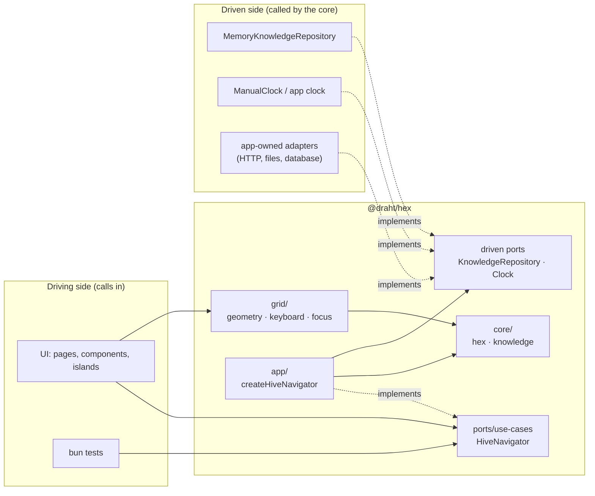

# Architecture

`@draht/hex` is the framework-free core of a hexagonal knowledge hive, plus the pure grid math a UI needs to draw and operate it. The domain model and rules live here. Anything that touches a framework, the DOM, the network, storage or time sits behind a port or stays in the consuming app.

The layering follows Ports & Adapters ("hexagonal architecture", Alistair Cockburn, <https://alistair.cockburn.us/hexagonal-architecture>). The overlap with the hex *grid* is a coincidence: the grid is domain, the architecture is structure.

## 1. Layers and the dependency rule



Rule: **dependencies point inwards only**: adapters → ports → core, app → ports and core, grid → core. The core imports nothing.

| Folder | May import (relative) | Packages | Must not import |
|---|---|---|---|
| `src/core/` | core | none | every other layer |
| `src/ports/` | core, ports | none | app, grid, adapters, contracts |
| `src/app/` | core, ports, app | none | grid, adapters, contracts |
| `src/grid/` | core, grid | none | ports, app, adapters, contracts; DOM |
| `src/adapters/` | core, ports, adapters | none | app, grid, contracts; DOM, timers |
| `src/contracts/` | core, ports, adapters, contracts | `bun:test` | app, grid |
| `src/index.ts` | any layer (public barrel) | none | |

No file inside a layer imports `src/index.ts` or anything outside `src/`.

These rules are enforced, not only documented:

- `tsconfig.json` compiles `core`, `ports`, `app` and `grid` with `lib: ["ES2022"]` and `types: []`. `window`, `document`, `KeyboardEvent`, `setTimeout`, `fetch` and `process` do not type-check there.
- `test/purity.test.ts` resolves every relative import (`import`, `import type`, `export … from`, side-effect and dynamic `import()`) to the top-level `src/` folder it lands in and checks the edge against the table above. Synthetic forbidden edges and a mutation check (a forbidden import appended to a real file) prove that the guard fails when it should.
- The same test fails on unknown folders, non-relative imports outside the allowed packages, ambient time or randomness (`Date.now`, `new Date`, `Math.random`), timers, network calls, runtime/DOM globals, DOM types and any framework import.

As a result, every core and grid function is deterministic: the same inputs give the same output.

## 2. Domain (`core/`)

| Module | Content |
|---|---|
| `core/hex.ts` | Axial pointy-top coordinates `HexCoord {q, r}`, six directions `E NE NW W SW SE` (counter-clockwise from east), neighbors, `directionTo`, distance, ring/spiral, rounding, plane ↔ hex, corners |
| `core/knowledge.ts` | Levels `university → area → person`, `Cell`, `CellKind`, `CellTarget` (route, URL or level), `CellLink`, `CellView`, `LevelView`, `neighborSlots`, `navigate`, `canAttach` (growth rule: a new cell must touch an existing one), `attachSlots`. No URL scheme: apps map levels to routes themselves (README, "URLs are the app's job") |

`CellKind` is a closed union (`topic`, `lesson`, `episode`, `exercise`, `course`, `link`, `level-portal`), listed at runtime as `CELL_KINDS` with the guard `isCellKind`. The kind labels a cell for rendering; the hive rules treat all kinds alike, and `Cell.target` decides where a cell leads. Adapters reading external data validate kinds at that boundary and reject or map unknown values there.

## 3. Ports

### Driving port (`ports/use-cases.ts`)

```ts
interface HiveNavigator {
  rootLevel(): Promise<Level>;                                              // the university level
  findLevel(kind: 'area' | 'person', handle: string): Promise<Level | undefined>;
  openLevel(level: LevelRef): Promise<LevelView | undefined>;               // level + sorted cells + breadcrumb/parent/children/attachSlots
  open(level: LevelRef, focus?: HexCoord): Promise<CellView | undefined>;
  step(from: Cell, dir: HexDirection): Promise<CellView | undefined>;
  attach(input: { level: LevelRef; coord: HexCoord; kind: CellKind; title: string; summary?: string })
    : Promise<{ ok: true; cell: Cell } | { ok: false; reason: string }>;  // enforces the growth rule
}
```

`createHiveNavigator({ repo, clock })` in `src/app/` implements it. UI code depends on the interface and never re-implements the rules.

### Driven ports

| Port | File | Shape | Implementations here |
|---|---|---|---|
| `KnowledgeRepository` | `ports/knowledge-repository.ts` | `getRoot, getLevel, findLevelByHandle, listChildren, listCells, getCell, getCellAt, listLinks, saveCell, saveLink, deleteCell` (all async) | `MemoryKnowledgeRepository` (seeded with fictional `MOCK_KNOWLEDGE` by default) |
| `Clock` | `ports/clock.ts` | `now()`, `every(intervalMs, onTick) → stop` | `ManualClock` (time moves only on `advance(ms)`) |

`KnowledgeRepository` is also the persistence boundary. Durable storage means a new adapter for this port, not a second port. Every adapter should pass `knowledgeRepositoryContract` from `@draht/hex/contracts`.

## 4. Grid (`grid/`)

The grid module holds pure functions only. Ids and coordinates go in; positions, intents and ids come out. Each app keeps its own markup, styling, routing and DOM focus handling.

| Module | Content |
|---|---|
| `grid/geometry.ts` | `GridOrientation` (`'pointy'` \| `'flat'`), `orientPoint`, `gridPoint`, `gridCorners`, `gridPolygon`, `gridBounds`, `directionAngle`, `nearestDirections` (nearest direction; on a tie the counter-clockwise one plus the clockwise one as `fallback`), `nearestDirection`, `gridNeighbor`, `readingOrder` |
| `grid/keyboard.ts` | `keyIntent(event, { orientation, keymap })` → `move \| first \| last \| activate \| up \| null` (a tied `move` also carries `fallback`; `null` for Ctrl/Meta/Alt/Shift, IME input and dead keys), `DEFAULT_KEYMAP`, opt-in `UP_LEVEL_KEYS`, `lookupBinding` |
| `grid/focus.ts` | `gridTabStop` (roving tabindex: focused, selected, `initialId`, then the first enabled cell in input order or, opt-in, reading order), `gridMove` (one step, `fallback` only when the primary slot is empty or disabled; returns the id and the direction taken), `gridAction` (intent + cells + current id → focus/activate/up; a move reports its `direction`; a disabled current cell yields nothing but `up`), `focusableCells` |

Orientation is presentation only. The domain stays pointy-top, and `'flat'` rotates the drawing 30° clockwise. Keyboard moves resolve by screen angle, so a key always moves toward the side of the screen it points to, in either orientation. The README documents the full key table.

## 5. Composition roots

Wiring happens in one place per app. Nothing inside `core`, `app` or `adapters` constructs its own dependencies.

```ts
const navigator = createHiveNavigator({ repo: new MemoryKnowledgeRepository(seed), clock: appClock });
```

To swap an adapter, change one line in the composition root, for example `new MemoryKnowledgeRepository(seed)` to `new HttpKnowledgeRepository(baseUrl)`.

## 6. Layout

```
src/
  core/        pure domain: hex math, knowledge model and rules
  ports/       interfaces: HiveNavigator (driving), KnowledgeRepository and Clock (driven)
  app/         application service: createHiveNavigator
  grid/        pure grid math: geometry, keyboard intents, roving focus
  adapters/    framework-free adapters: memory repository + mock data, manual clock
  contracts/   reusable bun:test suites for adapters
  index.ts     core + ports + app + grid
test/          domain, navigator, adapters, contract, grid and purity tests
```

## 7. Tests

1. **Domain and grid unit tests**: pure functions, no mocks. The keyboard tests cover every default key in both orientations (including tie fallbacks), modifier, IME and dead-key pass-through, layouts, and opt-in keys. The focus tests cover the tab-stop order, disabled and unknown current cells, Home/End, fallback moves with the direction taken, and that arrow keys alone reach every neighbor in both orientations. The domain tests check that every cell kind, `course` included, follows the same hive rules.
2. **Use-case tests**: `createHiveNavigator` over `MemoryKnowledgeRepository` and `ManualClock`.
3. **Contract tests**: `knowledgeRepositoryContract` runs against `MemoryKnowledgeRepository`. External adapters reuse it.
4. **Purity guard**: enforces the dependency rule (section 1), including a mutation check that a forbidden edge fails.

`bun run check` typechecks with the pinned TypeScript 6.x and with TypeScript 5.9 (consumers compile the source with their own compiler), then runs all tests, the purity guard among them.

## 8. Out of scope

- Rendering, routing, data fetching and persistence adapters: these belong to the consuming apps.
- Real content and personal data. The bundled mock data is fictional.
